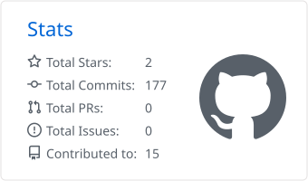
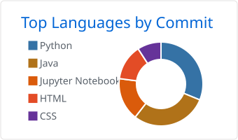

<h1 align="center">Santiago Tene</h1>

  <b>Computer Science Engineer</b> · AI &amp; Machine Learning · Software Engineering · Cybersecurity 
  <i>Engineering intelligent and secure software systems.</i>

  
  
  
  
  

---

## About me

- 🎓 Computer Science Engineer from **Universidad Nacional de Loja** (Ecuador), on the machine learning track: data mining, computer vision, deep learning and neural networks.
- 🚀 Co-founder at **[Tas Tas Soluciones](https://tastasweb.com/)**, building software solutions for clients.
- 🧠 Main interests: **AI / ML**, **software engineering** and **cybersecurity**.
- 🌎 Based in Ecuador and **open to remote opportunities**.

<a href="https://santiagotene.online/en/#projects">More on my portfolio →</a>

## Tech stack

| Area | Technologies |
| :--- | :--- |
| **Languages** |       |
| **AI / ML** |        |
| **Backend** |       |
| **Frontend & Mobile** |      |
| **Cloud & DevOps** |      |

## GitHub stats

<!-- Cards are generated by .github/workflows/profile-assets.yml and published to the `output` branch. -->

  <picture>
    <source media="(prefers-color-scheme: dark)" srcset="https://raw.githubusercontent.com/santy10e/santy10e/output/stats/dark/3-stats.svg" />
    
  </picture>
  <picture>
    <source media="(prefers-color-scheme: dark)" srcset="https://raw.githubusercontent.com/santy10e/santy10e/output/stats/dark/2-most-commit-language.svg" />
    
  </picture>

  <picture>
    <source media="(prefers-color-scheme: dark)" srcset="https://github-readme-streak-stats.herokuapp.com/?user=santy10e&theme=dark&hide_border=true&background=00000000" />
    
  </picture>

  <picture>
    <source media="(prefers-color-scheme: dark)" srcset="https://raw.githubusercontent.com/santy10e/santy10e/output/snake-dark.svg" />
    
  </picture>

